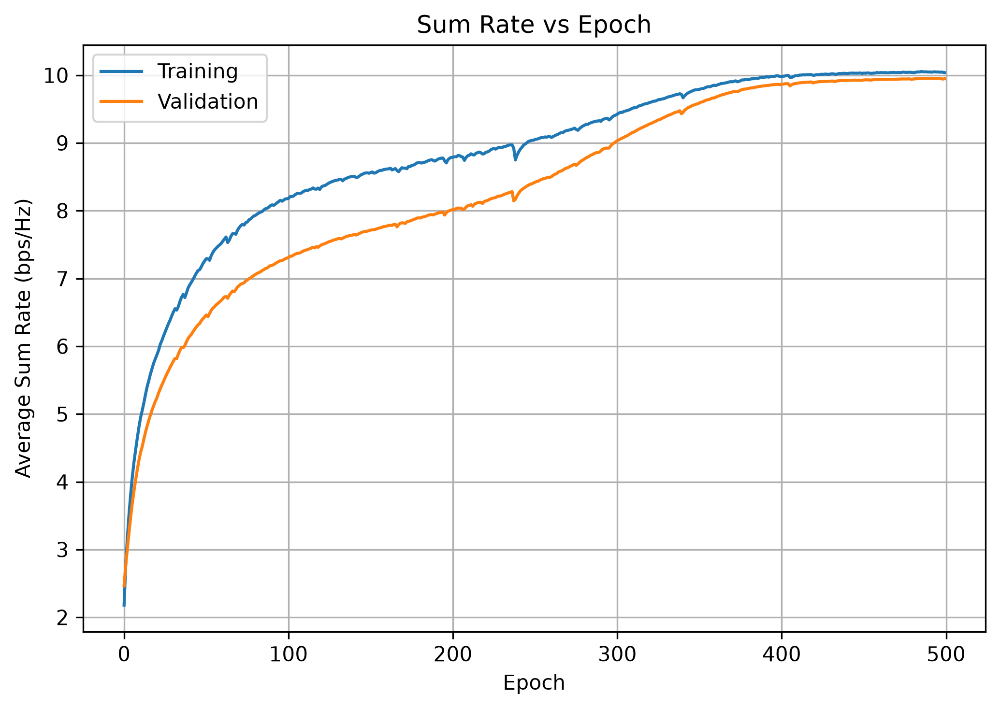
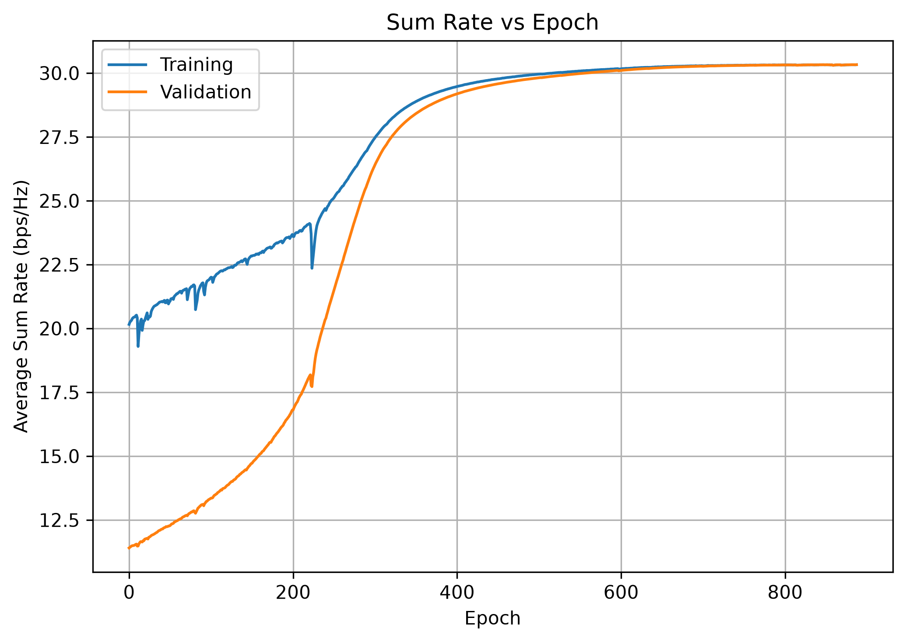

# Deep Learning-Based Hybrid Beamforming for Downlink Users and Targets

This project uses a neural network to design the analog (RF) precoder of a hybrid beamforming system, instead of running an iterative optimizer for every channel. The digital (baseband) precoder is not learned. It is computed in closed form from KKT conditions for whatever RF precoder the network produces.

The work has two stages:

1. **Stage 1: communication only.** One network, one objective (sum MSE), a single-path LoS channel.
2. **Stage 2: ISAC extension.** The same kind of network also illuminates sensing targets, using a multipath channel and a weighted communication-plus-sensing loss.

The two stages use different channel models, so their absolute sum rates are not directly comparable (see Section 7).

---

## 1. System setup

| Item | Value |
|---|---|
| Transmit antennas | M = 128 (ULA, spacing λ/2) |
| RF chains | N_RF = 4 |
| Users | K = 4, single antenna |
| Carrier frequency | 100 GHz (λ = 3 mm) |
| User range | 5 m to 80 m |
| Rayleigh distance | 2D²/λ ≈ 24.2 m |
| Total transmit power | P_t = 1 W |
| Noise power | σ² = 0.1 (nominal 10 dB SNR) |

Only part of the 5 to 80 m range lies inside the Rayleigh distance, so the data mixes near-field and far-field users. A spherical-wave model is used for every user instead of the far-field plane-wave approximation.

### 1.1 Signal model

The transmitted signal is

$$
\mathbf{x} = \mathbf{F}_{\mathrm{RF}}\,\mathbf{F}_{\mathrm{BB}}\,\mathbf{s},
$$

where `F_RF` ∈ ℂ^(M×N_RF) is the analog precoder, `F_BB` ∈ ℂ^(N_RF×K) is the digital precoder and `s` carries the K data streams. The analog precoder models phase shifters, so every entry has constant modulus 1/√M. The total power is limited by ‖`F_RF F_BB`‖² ≤ P_t.

### 1.2 Channel model used in Stage 1 (single-path LoS)

The Stage 1 channel (`channel_model_los.py`) gives each user one line-of-sight path:

$$
\mathbf{h}_k = \sqrt{M\,(r_{\mathrm{ref}}/r_k)^{\eta}}\;e^{j\varphi_k}\;\mathbf{b}(\theta_k, r_k)
$$

- **Position:** sin θ_k ~ U[−1, 1] and r_k ~ U[r_min, r_max], drawn independently per user.
- **Phase:** φ_k ~ U[0, 2π) stands in for the unknown absolute propagation phase.
- **Path loss:** (r_ref / r_k)^η with r_ref = 5 m and η = 2. The gain falls from 1 at 5 m to 1/256 at 80 m, a spread of about 24 dB. Its mean over uniform r is r_ref²/(r_min·r_max) = 1/16 (about −12 dB), so E‖h_k‖² = M/16.
- **Steering vector:** b(θ, r) has entries e^{−j2π(r_m − r)/λ}/√M, where r_m = √(r² + (δ_m d)² − 2 r δ_m d sin θ) is the true distance from element m and δ_m = (2m − M + 1)/2 is its offset from the array center. It depends on both angle and range, so it captures wavefront curvature.
- **Assumptions:** narrowband, uniform amplitude across the array (the path loss uses the center distance r, not each r_m), a single path with no scatterers or fading, isotropic elements, independent user positions and perfect CSI.

---

## 2. Neural network

`MultiuserAnalogPrecoderNet` takes the channel matrix `H` ∈ ℂ^(M×K) and outputs the analog precoder `F_RF`.

A shared per-user complex MLP processes each user's channel vector. Its hidden layers have sizes 512 → 256 → 128, and each block is `ComplexLinear` → `ComplexBatchNorm` → `ComplexTanh`. The K user features are concatenated, passed through a merge layer that outputs M·N_RF complex values, and reshaped to M × N_RF. A final `CMNormalization` layer divides each entry by its magnitude and scales by 1/√M:

$$
\left|[\mathbf{F}_{\mathrm{RF}}]_{m,n}\right| = \frac{1}{\sqrt{M}}.
$$

The output therefore always satisfies the phase-shifter constraint, and the network only has to learn the phases. The Stage 1 model has about 0.99 M real parameters.

---

## 3. Digital precoder (KKT)

The network does not predict `F_BB`. For a given `F_RF`, the digital precoder minimizes the sum MSE under the power constraint. For user k, the MSE with optimal scaling is

$$
\mathrm{MSE}_k = 1 - \frac{|\mathbf{h}_k^H \mathbf{F}_{\mathrm{RF}} \mathbf{f}_{\mathrm{BB},k}|^2}{\sum_j |\mathbf{h}_k^H \mathbf{F}_{\mathrm{RF}} \mathbf{f}_{\mathrm{BB},j}|^2 + \sigma^2}.
$$

For fixed `F_RF` the problem is convex with one active power constraint, and the KKT conditions give a closed form:

$$
\tilde{\mathbf{F}}_{\mathrm{BB}} = \big(\mathbf{F}_{\mathrm{RF}}^H\mathbf{H}\mathbf{H}^H\mathbf{F}_{\mathrm{RF}} + \tfrac{K\sigma^2}{P_t}\,\mathbf{F}_{\mathrm{RF}}^H\mathbf{F}_{\mathrm{RF}}\big)^{-1}\mathbf{F}_{\mathrm{RF}}^H\mathbf{H},
\qquad
\mathbf{F}_{\mathrm{BB}} = \beta\,\tilde{\mathbf{F}}_{\mathrm{BB}},
\quad
\beta = \sqrt{\frac{P_t}{\|\mathbf{F}_{\mathrm{RF}}\tilde{\mathbf{F}}_{\mathrm{BB}}\|_F^2}}.
$$

It is implemented with `torch.linalg.solve` (plus a small ridge for stability), so the whole calculation stays differentiable.

---

## 4. Concentrated MSE

Because `F_BB` is available in closed form for any `F_RF`, it does not need to be learned. Substituting it back into the MSE leaves a loss that depends only on the analog precoder:

$$
E(\mathbf{F}_{\mathrm{RF}}) = \mathrm{tr}\!\left[\left(\mathbf{I}_K + \frac{P_t}{K\sigma^2}\,\mathbf{H}^H\mathbf{F}_{\mathrm{RF}}(\mathbf{F}_{\mathrm{RF}}^H\mathbf{F}_{\mathrm{RF}})^{-1}\mathbf{F}_{\mathrm{RF}}^H\mathbf{H}\right)^{-1}\right].
$$

During training:

1. The channel `H` goes into the network.
2. The network outputs `F_RF`.
3. The loss `E(F_RF)` is evaluated directly, which uses the KKT digital precoder implicitly.
4. The loss is backpropagated through the whole calculation. No labels are needed.

This is the **concentrated MSE**. It leaves the network with a smaller problem than learning both precoders, and for every analog precoder the network produces, the digital precoder is exactly optimal.

---

## 5. Training configuration (Stage 1)

| Item | Value |
|---|---|
| Channel realizations | 20,000 (70% train / 15% validation / 15% test) |
| Batch size | 1024 |
| Optimizer | AdamW (weight decay 1e-4), gradient clipping at 5 |
| Initial learning rate | 7.5e-4 |
| Scheduler | ReduceLROnPlateau on validation sum rate (factor 0.5) |
| Early stopping | patience of 50 epochs on validation sum rate |
| Maximum epochs | 500 |

---

## 6. Stage 1 results (communication only)

### 6.1 Training curves


The concentrated MSE falls from about 3.15 to about 0.80. Training is mostly smooth, with a few small bumps around epochs 230 to 250, and the loss plateaus around epoch 400.



The training and validation sum rates rise from about 2.3 bps/Hz to about 10 bps/Hz. Training stays slightly ahead of validation for most of the run, and the two curves end up close together, so there is no large generalization gap.

### 6.2 Test-set comparison

All values are averaged over the test set.

| Configuration | Avg sum rate (bps/Hz) | Avg MSE |
|:---|---:|---:|
| Random F_RF + ZF F_BB | 0.1466 | 3.9019 |
| Random F_RF + random F_BB | 0.3304 | 3.9675 |
| Matched-filter F_RF + ZF F_BB | 9.0242 | 3.9497 |
| Matched-filter F_RF + random F_BB | 1.4009 | 3.8805 |
| Matched-filter F_RF + KKT F_BB | 10.0851 | 0.8190 |
| **Neural-network F_RF + KKT F_BB** | **9.9044** | **0.8469** |
| Full-digital F_RF + ZF F_BB | 10.0851 | 0.8190 |
| SOMP F_RF | 8.2772 | 1.3294 |

> **Note.** The "Matched-filter + KKT" and "Full-digital + ZF" rows are identical to four decimals. Check that they do not share a code path before treating the full-digital row as an independent upper bound.

### 6.3 What the numbers say

- The network reaches **9.9044 bps/Hz**.
- The best entry in the table is 10.0851 bps/Hz, so the network is about **1.8% below it**: (10.0851 − 9.9044)/10.0851 ≈ 1.8%.
- The network is about **19.7% above SOMP** (9.9044 vs 8.2772 bps/Hz).
- In this single-path LoS setting, matched-filter analog beams with the KKT digital stage are already very strong. The network does not beat them. What it offers is a one-pass design that does not depend on per-user phase conjugation.
- The KKT digital stage matters a great deal. Matched-filter analog with a ZF digital stage reaches only 9.02 bps/Hz, while the same analog stage with KKT reaches 10.09 bps/Hz.

### 6.4 Example beam pattern


This is one test channel with user angles [29.59°, 79.12°, 49.43°, 79.43°] and ranges [40.18 m, 50.51 m, 78.06 m, 38.54 m]. It reaches a sum rate of 8.0726 bps/Hz with MSE 1.0259.

The pattern peaks near the user directions. The strongest peak is at about 50.72°, close to the user at 49.43°, and sidelobes sit roughly 15 to 30 dB below the main peaks. The general MSE and the concentrated MSE agree on this example, which confirms the KKT digital stage is used consistently.

### 6.5 Inference time

Measured per sample (one multi-user channel matrix) and averaged over 500 channel realizations:

| Method | Average inference time |
|---|---:|
| Neural network | **10.59 ms/sample** |
| SOMP | **704.11 ms/sample** |

The network is about **66× faster**. SOMP runs a greedy search for every channel, whereas the network needs a single forward pass.

### 6.6 Summary of Stage 1

- The network generates a constant-modulus RF precoder directly from the channel, and the output satisfies the phase-shifter constraint by construction.
- The digital precoder is computed in closed form, so the network only learns the RF precoder.
- It achieves 9.9044 bps/Hz, within about 1.8% of the best configuration and about 19.7% above SOMP.
- It runs in about 10.59 ms per sample against 704.11 ms for SOMP.

---

## 7. Stage 2: ISAC extension (joint communication and target illumination)

The analog-precoder network is extended so that the same constant-modulus precoder serves K downlink users and illuminates T targets. No dedicated sensing beams or extra RF chains are used. Only communication symbols are transmitted, and the analog precoder shapes where that energy goes.

### 7.1 Channel model used in Stage 2 (multipath)

The ISAC runs use a multipath near-field channel (`channel_model_1.py`) with L = 3 paths per user (L = 3 is taken from the checkpoint name `ISAC_128_L3`):

$$
\mathbf{h}_k = \sqrt{\tfrac{M}{L}}\sum_{\ell=1}^{L}\alpha_\ell\,e^{-j2\pi r_\ell/\lambda}\,\mathbf{b}(\theta_\ell, r_\ell)
$$

- **Path parameters:** sin θ_ℓ ~ U[−1, 1], r_ℓ ~ U[r_min, r_max] and α_ℓ ~ CN(0, 1), all drawn independently.
- **Steering vector:** the same exact spherical-wave b(θ, r) as in Section 1.2.
- **Normalization:** E‖h_k‖² = M, with no distance-dependent path loss.
- **Assumptions:** narrowband, uniform amplitude across the array, no scatterer clustering, perfect CSI and single-antenna users. The common phase e^{−j2πr/λ} has no statistical effect, because CN(0, 1) is rotation-invariant.

Because this channel has no path loss and several paths per user, the Stage 2 sum rates (about 30 bps/Hz for communication only) are much higher than the Stage 1 values (about 10 bps/Hz).

### 7.2 Method

**Sensing model.** Targets are one-way receivers with unit-norm near-field steering vectors `B = [b(θ_t, r_t)]` ∈ ℂ^(M×T) (`target_model.py`). The power received at target t is

$$
G_t = \|\mathbf{b}_t^H\mathbf{F}_{\mathrm{RF}}\mathbf{F}_{\mathrm{BB}}\|^2,
$$

a transmit-side quantity with no array gain, round-trip loss or RCS. It is reported as a fraction of the transmit power P_t = 1 W.

**Digital precoder.** `F_BB` stays the communication-optimal KKT closed form from Section 3, so it needs no extra training.

**Loss** (`loss.py::isac_loss`):

```
L      = λ · E_c / K  +  (1 − λ) · L_sen / P_t
E_c    = concentrated MSE from Section 4
L_sen  = −(1/T) · Σ_t ||b_tᴴ F_RF F_BB||²        (F_BB detached from the graph)
```

The run reported below uses **λ = 0.5**, which matches the logged values: 0.5·(0.1915/4) + 0.5·(−0.2567) = −0.1044.

**Network change.** The target steering vectors are appended to the per-user inputs, so the shared MLP processes K + T = 7 columns. The merge layer input grows from 4·128 to 7·128, bringing the model to about 1.38 M real parameters (the constructor prints the exact count).

### 7.3 Experimental setup

| Item | Value |
|---|---|
| Array / users / targets | M = 128 ULA, K = 4, T = 3, N_RF = 4 |
| Carrier / Rayleigh distance | 100 GHz / 24.2 m |
| Power / noise | P_t = 1 W, σ² = 0.1 |
| Optimizer | AdamW, initial LR 7.5e-4, ReduceLROnPlateau (×0.5), gradient clip 5 |
| Epochs run | 1200 (best validation epoch 648; early stopping never triggered) |
| LR at end of run | 2.34e-5 (five halvings from 7.5e-4) |
| Training script | `train_128_isac.py` |
| Checkpoint | `models/Best_model_ISAC_128_L3.pt` |

### 7.4 Results

**Held-out test set, best checkpoint:**

| Metric | Value |
|---|---|
| Sum rate | **15.507 bps/Hz** |
| Average sensing power | **0.246961** (per target, fraction of P_t) |
| Target 1 / 2 / 3 | 0.238539 / 0.256215 / 0.246129 |
| Total power on the 3 targets | 0.7409 of P_t |
| Reference sum rate (logged as "MF baseline") | 30.343 bps/Hz |
| Sum rate relative to reference | 51.1% (loss of 14.84 bps/Hz) |

The reference value is close to where the communication-only (λ = 1) run converges, about 30.3 bps/Hz.

**Training and validation at the final epoch (1200):**

| Quantity | Value |
|---|---|
| Total training loss | −0.1045 |
| Communication loss E_c (training) | 0.1914 |
| Sensing loss L_sen (training) | −0.2568 |
| Training sum rate | 17.769 bps/Hz |
| Validation sum rate | 15.310 bps/Hz (best 15.481 at epoch 648) |
| Validation sensing power (average) | 0.2530 (targets: 0.2514 / 0.2659 / 0.2417) |
| Validation reference rate / percent | 30.318 bps/Hz / 50.5% |
| Early-stopping counter | 552 (no improvement since epoch 648) |

Validation and test differ by about 1 to 2% (15.31 vs 15.51 bps/Hz, 0.253 vs 0.247), which is ordinary sampling variation between two 3,000-sample splits.

### 7.5 Training dynamics





The values below are read off the plots, so they are approximate.

1. **Epochs 0 to about 120: communication first.** E_c falls from about 1.17 to about 0.16 and the training sum rate climbs to about 18.8 bps/Hz. The sensing loss barely moves (about −0.008, which is the P_t/M ≈ 0.0078 level you would expect from a random constant-modulus beam).
2. **Epochs about 130 to 300: the trade-off appears.** L_sen drops steeply from about −0.02 to about −0.21. E_c rises to about 0.23 and the training sum rate falls to roughly 16.5 to 17 bps/Hz.
3. **Epochs 300 to 1200: slow settling.** L_sen levels off at −0.257 and E_c at 0.191. The training sum rate plateaus at about 17.77 bps/Hz. The total loss goes from about 0.142 to −0.1045.

### 7.6 Beam patterns (one test sample)


- Three dominant lobes appear at about −56°, +35° and +49° (peaks at about −2.5, −1 and 0 dB). Most sidelobes sit between −20 and −30 dB.
- The 2-D pattern over 2 to 24 m (inside the Rayleigh distance) shows **vertical stripes**. The learned beam is concentrated in angle, with no visible range focusing in this window.

### 7.7 Analysis

**Sensing gain.** A random constant-modulus beam delivers P_t/M = 1/128 ≈ 0.0078 per target. The trained network reaches 0.247, which is **31.6× (about +15 dB)**.

**Upper bound.** For near-orthogonal targets, Σ_t ‖b_tᴴx‖² ≤ λ_max(BBᴴ)·P_t ≈ P_t, so the per-target ceiling is about 1/T = 0.333. The network reaches **about 74%** of it, and the three targets are well balanced (max/min = 1.074, about 0.3 dB).

**Why the sum rate roughly halves.** The product F_RF·F_BB lives in an N_RF = 4 dimensional subspace. Communication already needs that subspace to serve 4 users, and the 3 targets compete for it. This degrees-of-freedom limit explains the drop, and it suggests that N_RF > K should recover some rate at the same sensing level.

**Generalization gap.** The training sum rate (17.77) is 2.46 bps/Hz above validation (15.31), or 13.8% of the training value. The sensing gap is only 1.5% (0.2568 vs 0.2530), so the overfitting is in the communication part. In the communication-only run the training and validation curves coincide at about 30.3 bps/Hz.

**Loss-to-rate sanity check.** If all users had the same SINR, with MSE = 1/(1 + SINR), then E_c = 0.1914 would correspond to about 17.5 bps/Hz (measured training rate 17.77), and the communication-only E_c ≈ 0.0227 would correspond to about 29.8 bps/Hz (measured about 30.3). The loss and the rate tell the same story.
