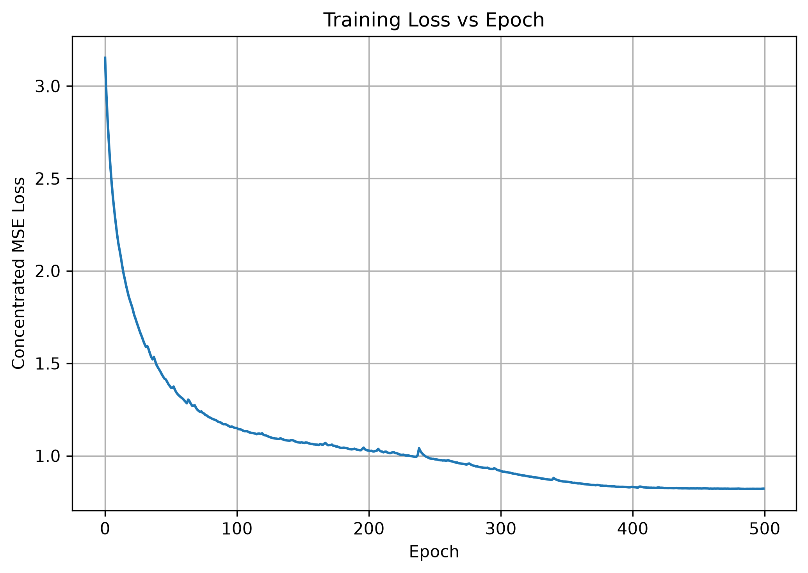
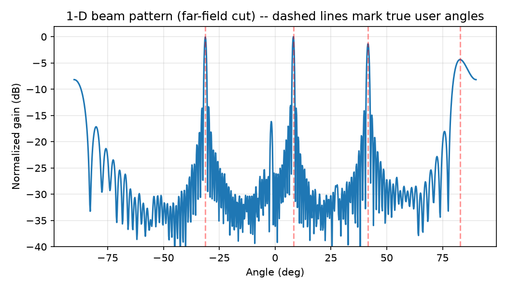

# Deep Learning Based Hybrid Beamforming.

This project is the first stage of a  hybrid beamforming system for multi-user communication.

The objective is to use a neural network to design the analog (RF) precoder instead of using conventional iterative methods. The digital (baseband) precoder is calculated separately using a KKT-based solution.

This stage only considers communication. No sensing or ISAC objective is included yet.

---

## 1. System Setup

The system consists of:

* `M = 128` transmit antennas
* `N_RF = 4` RF chains
* `K = 4` single-antenna users
* Carrier frequency: `100 GHz`
* Antenna spacing: `λ/2`
* Single-antenna users
* Near-field LoS-dominant channel
* User ranges between `5 m` and `80 m`
* Near-field boundary: approximately `R = 25 m`

The selected range includes both near-field and far-field users.

A spherical-wave channel model is used for all users instead of the far-field plane-wave approximation.

The transmitted signal is
\[
\mathbf{x}
=
\mathbf{F}_{\mathrm{RF}}
\mathbf{F}_{\mathrm{BB}}
\mathbf{s}
\]

where:

* $\mathbf{F}_{\mathrm{RF}}$ is the analog/RF precoder
* $\mathbf{F}_{\mathrm{BB}}$ is the digital/baseband precoder
* $\mathbf{s}$ is the transmitted data signal

The RF precoder has constant-modulus entries because it represents a phase-shifter-based hardware implementation.

The total transmit power is limited to $P_t$.

---
### Channel Model (LoS)

The single-path line-of-sight model (`channel_model_los.py`) is used for the communication-only training script. The base station has an M-element ULA with half-wavelength spacing. Each of the K users has a single LoS path:

    h_k = sqrt(M · (r_ref / r_k)^η) · e^{jφ_k} · b(θ_k, r_k)

- **User position:** sin θ_k ~ U[−1, 1] and r_k ~ U[r_min, r_max], drawn independently per user.
- **Phase:** φ_k ~ U[0, 2π) stands in for the unknown absolute propagation phase.
- **Path loss:** (r_ref / r_k)^η with r_ref = 5 m and η = 2, so the large-scale gain goes from 1 at 5 m to 1/256 at 80 m, a spread of about 24 dB. Its expected value over uniform r is r_ref² / (r_min · r_max) = 1/16 (about −12 dB), so E‖h_k‖² = M/16.
- **Steering vector:** b(θ, r) is the exact spherical-wave response, with entries e^{−j2π(r_m − r)/λ} / √M. Here r_m = √(r² + (δ_m d)² − 2 r δ_m d sin θ) is the true distance from element m, and δ_m = (2m − M + 1)/2 is its offset from the array center. It depends on both angle and range, so it captures wavefront curvature.
- **Assumptions:** narrowband, uniform amplitude across the array (the path loss uses the center distance r, not each r_m), a single path with no scatterers or fading, isotropic elements, independent user positions, and perfect CSI.
- **Near-field boundary:** the Rayleigh distance is 2D²/λ ≈ 24.2 m (M = 128, 100 GHz), so only part of the range [5, 80] m is in the near field.
## 2. Neural Network

The neural network is called `MultiuserAnalogPrecoderNet`.

It takes the channel matrix

$$
\mathbf{H} \in \mathbb{C}^{M\times K}
$$

as input and produces the analog precoder

$$
\mathbf{F}_{\mathrm{RF}}
\in
\mathbb{C}^{M\times N_{\mathrm{RF}}}.
$$

The network only predicts the RF precoder. The digital precoder is calculated separately.

### Network structure

The main hidden layers use the following dimensions:

```text
512 → 256 → 128
```

The network uses complex-valued layers:

* `ComplexLinear`
* `ComplexBatchNorm`
* `ComplexTanh`

The final `CMNormalization` layer converts the network output into a constant-modulus RF precoder.

Each element satisfies

$$\left|[\mathbf{F}_{\mathrm{RF}}]_{m,n}\right|$$
=
$$\frac{1}{\sqrt{M}}.$$

Therefore, the output of the network already satisfies the RF phase-shifter constraint.

The network mainly needs to learn the appropriate phases of the RF precoder.

---

## 3. Digital Precoder Calculation

The network does not directly predict $\mathbf{F}_{\mathrm{BB}}$.

For a given RF precoder, the effective channel is calculated and the digital precoder is obtained using a KKT-based solution.

For user $k$, the MSE is written as

$$
\mathrm{MSE}_k =
1 -
\frac{
\left|
\mathbf{h}_k^H
\mathbf{F}_{\mathrm{RF}}
\mathbf{F}_{\mathrm{BB},k}
\right|^2
}{
\sum_j
\left|
\mathbf{h}_k^H
\mathbf{F}_{\mathrm{RF}}
\mathbf{F}_{\mathrm{BB},j}
\right|^2
+
\sigma_k^2
}.
$$

The objective is to minimize the sum MSE while satisfying the transmit power constraint.

For a fixed $\mathbf{F}_{\mathrm{RF}}$, the digital precoder is obtained from the KKT solution in the reduced `N_RF`-dimensional effective channel.

The solution is implemented using:

```python
torch.linalg.solve
```

This keeps the complete calculation differentiable during training.

---

## 4. Concentrated MSE

Since the digital precoder can be calculated for any given RF precoder, it does not need to be treated as another variable for the neural network to learn.

During training:

1. The channel matrix $\mathbf{H}$ is given to the neural network.
2. The network generates $\mathbf{F}_{\mathrm{RF}}$.
3. The effective channel is calculated.
4. The KKT solution is used to obtain $\mathbf{F}_{\mathrm{BB}}$.
5. The resulting MSE is calculated.
6. The loss is backpropagated through the complete calculation.

Therefore, the network only learns the RF precoder while the digital precoder is calculated for the current RF solution.

The resulting objective is referred to as the **concentrated MSE**.

This reduces the number of variables that the neural network needs to learn compared with directly learning both RF and baseband precoders.

---

## 5. Training Configuration

The training dataset contains:

```text
Total channel realizations : 20,000
Training set               : 70%
Validation set              : 15%
Test set                    : 15%
Batch size                  : 1024
Initial learning rate       : 7.5 × 10⁻⁴
Maximum epochs              : 500
Optimizer                   : Adam
```

A learning-rate scheduler is used when the validation loss stops improving.

Early stopping is also used with a patience of 50 epochs.

---

## 6. Training Results

### Training Loss



The concentrated MSE decreases from approximately `3.15` at the beginning of training to around `0.80`.

The training is generally stable, with a few small changes around epochs `230–250`, after which the loss continues to decrease.

The loss reaches a plateau at around `400` epochs.

### Sum Rate


The training and validation sum rates increase from approximately `2.3 bps/Hz` to around `10 bps/Hz`.

The training result remains slightly better than the validation result during most of the training.

The two curves become close to each other near the end of training, showing that the network is not showing a large difference between training and validation performance.

---

## 7. Test Set Comparison

The following results are obtained by averaging over the test set.

| Configuration | Avg Sum Rate (bps/Hz) | Avg MSE |
|:---|---:|---:|
| Random $\mathbf{F}_{\mathrm{RF}}$ + ZF $\mathbf{F}_{\mathrm{BB}}$ | 0.1466 | 3.9019 |
| Random $\mathbf{F}_{\mathrm{RF}}$ + Random $\mathbf{F}_{\mathrm{BB}}$ | 0.3304 | 3.9675 |
| Matched Filter $\mathbf{F}_{\mathrm{RF}}$ + ZF $\mathbf{F}_{\mathrm{BB}}$ | 9.0242 | 3.9497 |
| Matched Filter $\mathbf{F}_{\mathrm{RF}}$ + Random $\mathbf{F}_{\mathrm{BB}}$ | 1.4009 | 3.8805 |
| Matched Filter $\mathbf{F}_{\mathrm{RF}}$ + KKT $\mathbf{F}_{\mathrm{BB}}$ | 10.0851 | 0.8190 |
| **Neural Network $\mathbf{F}_{\mathrm{RF}}$ + KKT $\mathbf{F}_{\mathrm{BB}}$** | **9.9044** | **0.8469** |
| Full Digital $\mathbf{F}_{\mathrm{RF}}$ + ZF $\mathbf{F}_{\mathrm{BB}}$ | 10.0851 | 0.8190 |
| SOMP $\mathbf{F}_{\mathrm{RF}}$ | 8.2772 | 1.3294 |


### Key Observations

**1. Neural Network Performance**

The proposed neural network achieves an average sum rate of:

$$
\boxed{R_{\mathrm{NN}} = 9.9044 \ \text{bps/Hz}}
$$

**2. Comparison with the Best Result**

The best sum rate in the table is:

$$
R_{\mathrm{best}} = 10.0851 \ \text{bps/Hz}
$$

The relative performance gap is:

$$
\text{Gap} =
\frac{R_{\mathrm{best}}-R_{\mathrm{NN}}}
{R_{\mathrm{best}}}\times 100
\approx 1.8\%
$$

Thus, the neural network achieves a sum rate within approximately 1.8% of the best result.

**3. Comparison with SOMP**

The proposed neural network also outperforms the SOMP-based approach:

$$
9.9044 > 8.2772 \ \text{bps/Hz}
$$

**Conclusion**

These results demonstrate that the trained neural network can predict an effective analog RF precoder without requiring iterative SOMP execution for every channel realization, while achieving per...

### Note

The Matched Filter + KKT and Full Digital + ZF configurations give exactly the same values in the current implementation.

---

## 8. Beam Pattern



The figure shows an example test channel.

The user parameters for this example are:

```text
Angles = [29.59°, 79.12°, 49.43°, 79.43°]

Ranges = [40.18 m, 50.51 m, 78.06 m, 38.54 m]
```

The obtained performance is:

```text
Sum rate = 8.0726 bps/Hz
MSE      = 1.0259
```

The beam pattern shows peaks around the directions of the four users.

The strongest peak is around `50.72°`, which is close to the user at `49.43°`.

The sidelobes are generally around `15–30 dB` below the main peaks.

The general MSE and concentrated MSE give the same result for this example, which confirms that the KKT-based digital precoder calculation is being used consistently.

---

## 9. Inference Time

The inference time of the neural network is compared with the conventional SOMP method.

The measurements are averaged over `500` channel realizations.

Here, one sample means one multi-user channel matrix $\mathbf{H}$.

| Method         | Average inference time |
| -------------- | ---------------------: |
| Neural Network |  **10.5867 ms/sample** |
| SOMP           | **704.1061 ms/sample** |

The neural network requires approximately:

$$
10.59\ \text{ms/sample}
$$

while SOMP requires approximately:

$$
704.11\ \text{ms/sample}.
$$

Thus, the neural network is much faster during inference for the tested configuration.

The main difference is that SOMP performs an iterative optimization for each channel realization, whereas the trained neural network generates the RF precoder using a single forward pass.

---

## 10. Main Results

The main observations from Stage 1 are:

* The neural network can directly generate a constant-modulus RF precoder from the channel matrix.
* The digital precoder can be calculated separately using the KKT solution.
* The concentrated MSE approach allows the network to focus only on the RF precoder.
* The proposed neural network achieves `9.9044 bps/Hz` average sum rate.
* The best result in the current comparison is `10.0851 bps/Hz`.
* The neural network is approximately `1.8%` below the best result.
* The neural network performs better than the SOMP + TH-HMP baseline.
* The neural network inference time is approximately `10.59 ms/sample`, compared with `704.11 ms/sample` for SOMP.
* The constant-modulus constraint is satisfied directly by the network output.
* The current results provide the communication-only base for the next stage of the project.

---

## 11. Next Stage
## ISAC Extension: Joint Communication and Target Illumination
 
The analog-precoder network is extended so that the same constant-modulus precoder serves K downlink users and illuminates T targets. No dedicated sensing beams or extra RF chains are used. Only the communication symbols are transmitted, and the analog precoder shapes where that energy goes.
 ### Channel Model

Users are modeled with a multipath near-field channel (`channel_model_1.py`). The base station has an M-element ULA with half-wavelength spacing. For each user *k*, the channel is a sum of L paths (L = 3 in the ISAC runs):

    h_k = sqrt(M / L) · Σ_{ℓ=1..L} α_ℓ · e^{-j2πr_ℓ/λ} · b(θ_ℓ, r_ℓ)

- **Path parameters:** sin θ_ℓ ~ U[−1, 1], r_ℓ ~ U[r_min, r_max], and α_ℓ ~ CN(0, 1), all drawn independently.
- **Steering vector:** b(θ, r) is the exact spherical-wave response, with entries e^{−j2π(r_m − r)/λ} / √M. Here r_m = √(r² + (δ_m d)² − 2 r δ_m d sin θ) is the true distance from element m, and δ_m = (2m − M + 1)/2 is its offset from the array center. This captures wavefront curvature, so the response depends on both angle and range.
- **Normalization:** E‖h_k‖² = M. There is no distance-dependent path loss in this model.
- **Assumptions:** narrowband, uniform amplitude across the array, no scatterer clustering, perfect CSI, and single-antenna users.
- **Near-field boundary:** the Rayleigh distance is 2D²/λ ≈ 24.2 m (M = 128, 100 GHz), so only part of the user range is in the near field.
### Method
 
**Sensing model.** Targets are one-way receivers with unit-norm near-field steering vectors `B = [b(θ_t, r_t)] ∈ C^{M×T}` (`target_model.py`). The power at target *t* is `P_t = ||b_tᴴ F_RF F_BB||²`, which is a transmit-side quantity and does not include array gain, round-trip loss or RCS. `P_t` is expressed as a fraction of the transmit power (P_tx = 1 W).
 
**Digital precoder.** `F_BB` stays the communication-optimal KKT closed form (`kkt_precoder.py`), so the digital stage needs no extra training.
 
**Loss** (`loss.py::isac_loss`):
 
```
L = λ · E_c(F_RF) / K  +  (1 − λ) · L_sen / P_tx
E_c(F_RF) = tr[(I + P_tx/(Kσ²) · Hᴴ F_RF (F_RFᴴ F_RF)⁻¹ F_RFᴴ H)⁻¹]      (concentrated MSE)
L_sen     = −(1/T) · Σ_t ||b_tᴴ F_RF F_BB||²                            (F_BB detached)
```
 
The run reported below uses **λ = 0.5**. This follows from the logged values: 0.5·(0.1915/4) + 0.5·(−0.2567) = −0.1044.
 
**Network change.** The target steering vectors are appended to the per-user inputs, so the shared complex MLP sees K+T = 7 columns. The merge layer input grows from 4·128 to 7·128. By my count this gives about 1.38 M real parameters (about 0.99 M for the communication-only model). The model constructor prints the exact figure.
 
### Experimental setup
 
| Item | Value |
|---|---|
| Array / users / targets | M = 128 ULA, K = 4, T = 3, N_RF = 4 |
| Carrier / Rayleigh distance | 100 GHz / 24.2 m |
| Power / noise | P_tx = 1 W, σ² = 0.1 (nominal 10 dB SNR) |
| Optimizer | AdamW, initial LR 7.5e-4, ReduceLROnPlateau (×0.5), grad-clip 5 |
| Epochs run | 1200 (best validation epoch: 648) |
| LR at end of run | 2.34e-5 (five halvings from 7.5e-4) |
 
### Headline results (held-out test set, best checkpoint)
 
| Metric | Value |
|---|---|
| Sum rate | **15.507 bps/Hz** |
| Average sensing power | **0.246961** (per target, fraction of P_tx) |
| Target 1 / 2 / 3 | 0.238539 / 0.256215 / 0.246129 |
| Total power on the 3 targets | 0.7409 of P_tx |
| Reference sum rate (logged as "MF baseline") | 30.343 bps/Hz |
| Sum rate relative to reference | 51.1% (loss of 14.84 bps/Hz) |
 
### Validation and training (final epoch 1200)
 
| Quantity | Value |
|---|---|
| Total training loss | −0.1045 |
| Communication loss E_c (training) | 0.1914 |
| Sensing loss L_sen (training) | −0.2568 |
| Training sum rate | 17.769 bps/Hz |
| Validation sum rate | 15.310 bps/Hz (best 15.481 at epoch 648) |
| Validation sensing power (avg) | 0.2530 (targets: 0.2514 / 0.2659 / 0.2417) |
| Validation reference rate / percent | 30.318 bps/Hz / 50.5% |
| Early-stopping counter | 552 (no improvement since epoch 648) |
 
The validation and test numbers differ by about 1 to 2% (15.31 vs 15.51 bps/Hz, 0.253 vs 0.247 W), which is ordinary sampling variation across the two 3000-sample splits.
 
### Training dynamics
 


 
- Three dominant lobes appear at about −56°, +35° and +49° (peaks at about −2.5, −1 and 0 dB). Most sidelobes sit between −20 and −30 dB.
- The 2-D pattern over 2 to 24 m (inside the Rayleigh distance) shows **vertical stripes**. The learned beam is concentrated in angle and shows no visible range focusing in this window.
### Analysis
 
**Sensing gain.** A random constant-modulus beam delivers P_tx/M = 1/128 ≈ 0.0078 per target. The trained network reaches 0.247, which is **31.6× (about +15 dB)**.
 
**Upper bound.** For near-orthogonal targets, Σ_t ||b_tᴴ x||² ≤ λ_max(BBᴴ)·P_tx ≈ P_tx, so the per-target ceiling is about 1/T = 0.333. The network reaches **about 74%** of it. Per-target balance is good: max/min = 1.074 (0.3 dB).
 
**Why the sum rate halves.** F_RF F_BB lies in an N_RF = 4 dimensional subspace that communication already needs in order to serve 4 users, while 3 targets compete for the same subspace. This degrees-of-freedom limit explains the drop, and it suggests N_RF > K should recover rate at the same sensing level.
 
**Generalization gap.** The training sum rate (17.77) exceeds the validation sum rate (15.31) by 2.46 bps/Hz (13.8% of training). The sensing gap is only 1.5% (0.2568 vs 0.2530). Overfitting is therefore in the communication part. In the communication-only run (λ = 1) the training and validation curves coincide at about 30.3 bps/Hz.
 
**Loss-to-rate sanity check.** Assuming equal per-user SINR with MSE = 1/(1+SINR): E_c = 0.1914 corresponds to about 17.5 bps/Hz (measured training rate 17.77), and the communication-only E_c ≈ 0.0227 corresponds to about 29.8 bps/Hz (measured about 30.3). The loss and the rate are consistent.

